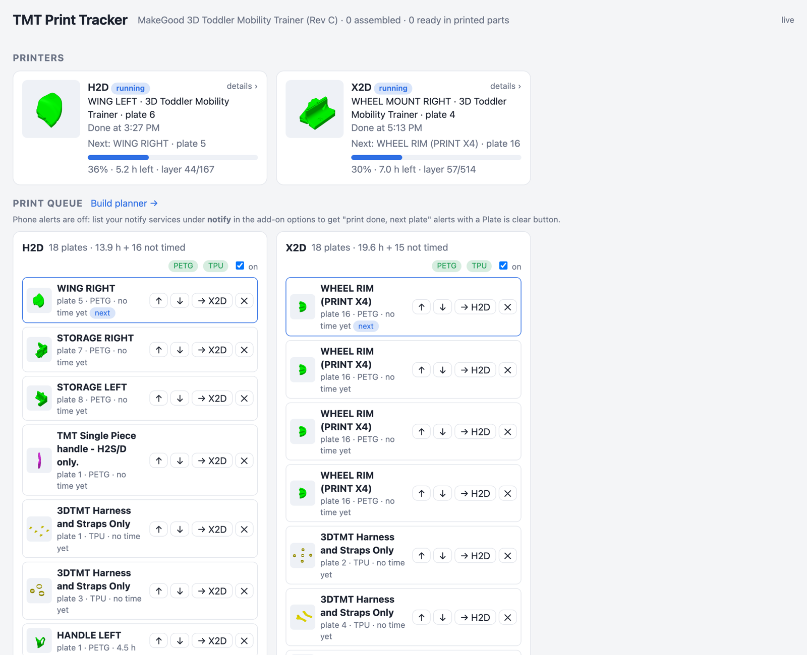
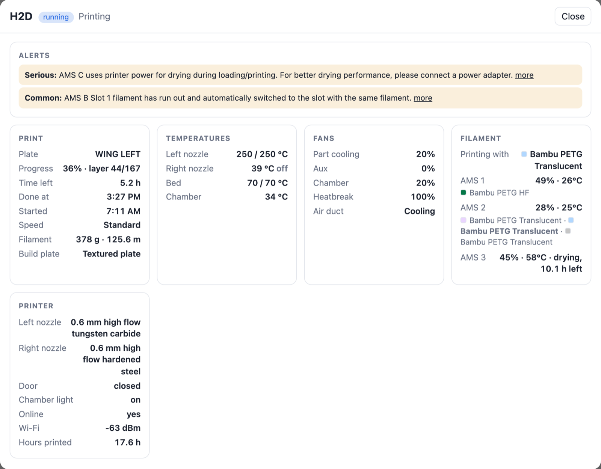
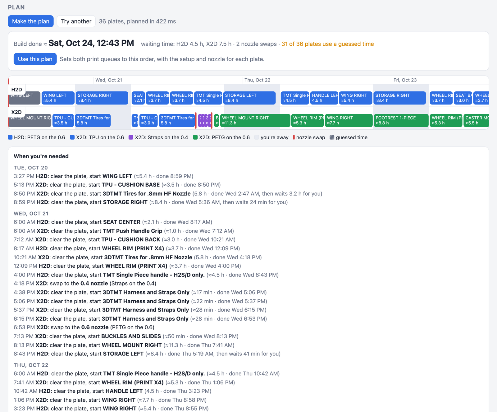
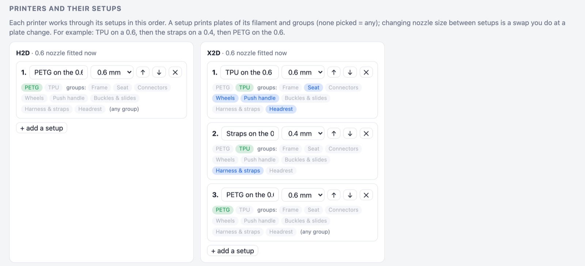
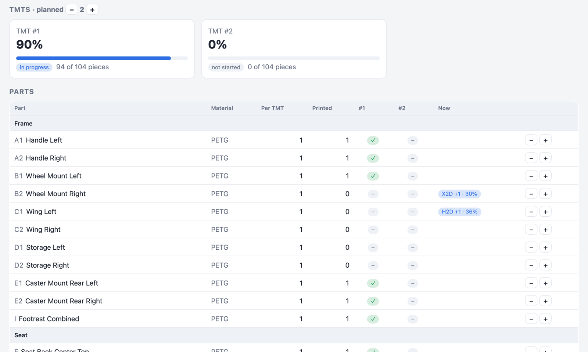

# TMT Print Tracker for Home Assistant

A Home Assistant app (add-on) for volunteer makers printing **Toddler Mobility Trainers (TMTs)**: the free, 3D-printed
mobility trainers for children organised by [3D Mobility](https://3d-mobility.org) and MakeGood.

It watches your **Bambu Lab** printers, keeps the parts list for you, and plans what each printer prints next.

## What it does

- **Parts list.** Every part a TMT needs (about 100 pieces), grouped the way you assemble them, with what's printed for
  each TMT you're building.
- **Recognises what's printing.** It works out which plate of which design file each printer is printing, from the job
  name and plate number or by comparing the printer's plate preview with your files' previews. Prints sent from
  MakerWorld or Bambu Handy are recognised too.
- **Counts finished plates.** A plate's parts are counted when the print finishes. Failed prints don't count, and you
  can correct anything by hand.
- **Print queue per printer.** The plates still needed are queued on the printers that have the right filament
  loaded, kept balanced, and re-planned whenever something prints, fails or changes. Reorder, move, skip or add plates.
- **Phone alerts (optional).** When a print ends you get the result, the TMT's progress and the next plate, with a
  **Plate is clear** button.
- **Printer details and camera.** Click a printer for its camera, temperatures, fans, speed, stage, filament and AMS
  humidity, and any printer alerts.
- **Print times, per printer.** Every print's real time is recorded for that printer (with the slicer's estimate, the
  filament and the nozzle; paused time left out), so the queue and planner know how long a plate takes there.
- **Build planner.** Plan a whole build across your printers: each printer's setups in order (say TPU on a 0.6, then
  the straps on a 0.4, then PETG on the 0.6), the hours you're around to clear plates, and the order that keeps the
  printers busiest, with long plates started in the evening to run overnight.

| Printer details | Build planner |
|---|---|
|  |  |

| Printer setups for the planner | Parts and progress |
|---|---|
|  |  |

## What you need

- Home Assistant OS or Supervised (apps/add-ons).
- Your Bambu Lab printers in Home Assistant through the
  [Bambu Lab integration](https://github.com/greghesp/ha-bambulab) (HACS).
- The TMT design files (`.3mf`) you print from. **They are not included here**: they belong to their designers.
  Download them as a maker, then upload them on the app's page.
- For the camera: **LAN Only Liveview** turned on in each printer's network settings.
- For phone alerts: the Home Assistant Companion app on your phone.

## Install

1. In Home Assistant: **Settings → Apps (Add-ons) → App store → ⋮ → Repositories**, add
   `https://github.com/boasist/tmt-print-tracker`.
2. Install **TMT Print Tracker**, start it, and turn on **Show in sidebar**.
3. Open **TMT** in the sidebar and upload your 3MF files under **Files**. The page lists any design file the build
   profile still needs.
4. Optional: for phone alerts, add your phone's notify service (for example `notify.mobile_app_my_phone`) under
   **notify** in the app's options.

Your printers are found automatically. See [the documentation](tmt_tracker/DOCS.md) for the queue, alerts, planner,
options and for changing the build (which plates count, quantities, either/or parts).

## Updating

Home Assistant checks this repository for new versions on its own, and lists an update for **TMT Print Tracker**
under **Settings** when one is out.

1. To look right away: **Settings → Apps (Add-ons) → App store → ⋮ → Check for updates**.
2. Open **TMT Print Tracker** and press **Update**. Leave **create a backup** ticked if you'd like to be able to go back.
3. Reload the **TMT** page in your browser.

What changed in each version is on the app's **Changelog** tab (and in [CHANGELOG.md](tmt_tracker/CHANGELOG.md)). Your
counts, history, queues, print times, plans and uploaded 3MF files are kept across updates. To install updates
automatically, turn on **Auto update** on the app's page. The version you're running is shown under **Files** on the
TMT page.

## The default build

The built-in profile follows MakeGood's 3D Toddler Mobility Trainer, Rev C, with these choices: one-piece footrest,
Rev B wheel rims (4, one per plate), 16 TPU tires from the 0.8 mm HF tire file, the single-piece push handle (H2-series
printers only, so it's only queued on those) and V2 push handle grip, the separate harness & straps file, kit caster
mounts, and as optional: one cup holder and one tablet holder (accessories, still queued and planned) and the
headrest. Copy and edit the profile to build it differently.

## Credits

TMT designs: MakeGood and the 3D Mobility maker community (including the contributors of the harness & straps, tire,
push handle grip, single-piece handle, cup holder and tablet holder designs). This project only tracks prints; it isn't affiliated with
MakeGood, 3D Mobility or Bambu Lab.

## License

MIT for the code in this repository. The TMT design files keep their own licenses.
